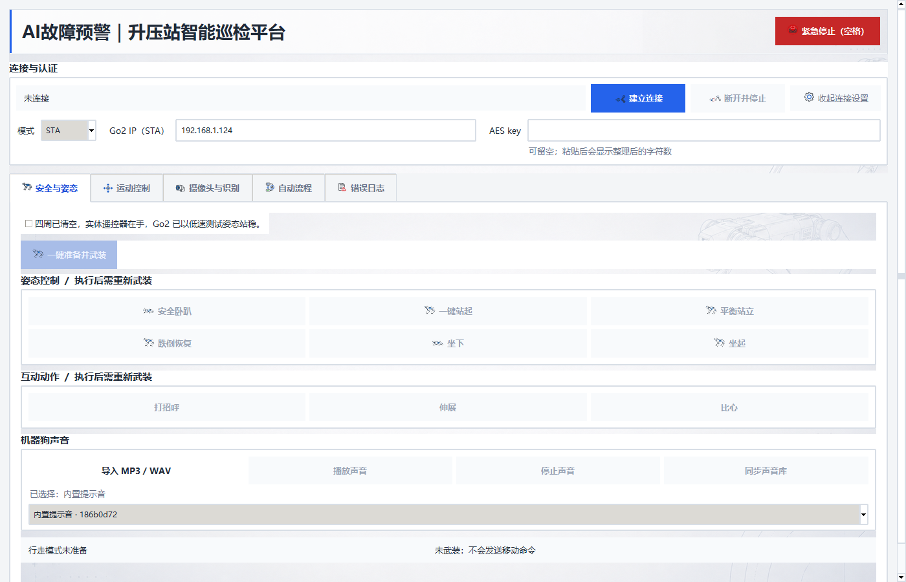
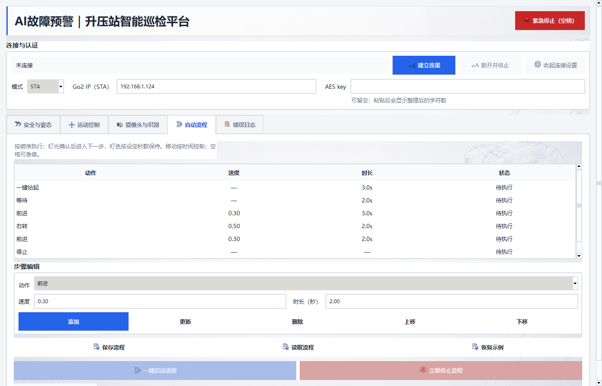

# AI故障预警｜升压站智能巡检平台

面向 Windows 的 Go2 Pro 远程二次开发与调试工具。项目使用 Python、Tkinter 和社区库 `unitree_webrtc_connect`，提供安全运动控制、姿态动作、摄像头预览、人员识别、自动流程和错误日志。

## 界面预览

主界面与声音控制：



自动流程编辑：



截图是在未连接机器狗时生成的，流程列表展示默认示例。

> [!WARNING]
> 这是会驱动实体机器人的实验性软件。首次测试必须清空四周、保持低速，并由旁人手持实体遥控器负责急停。不要在人员、宠物、楼梯、玻璃、车辆或贵重物品附近运行。

## 主要功能

- 启动时显示“AI故障预警｜升压站智能巡检平台”欢迎页，准备完成后自动进入控制台。
- STA / AP 两种 WebRTC 连接方式；AES key 只在当前进程中使用，不保存。
- 前后、横移和转向控制，支持按钮锁存与键盘按住控制。
- 安全卧趴、站起、平衡站立、跌倒恢复、坐下、坐起、打招呼、伸展和比心。
- “机器狗声音”可导入 MP3/WAV 到本机声音库。连接后点击一次“同步声音库”，程序会查询当前机器狗已有音频，仅上传缺少的文件；之后手动播放与自动流程均按机器狗上的声音 ID 直接播放，不在流程执行途中上传。转换后 WAV 上限为 10 MB；声音接口能否被具体 Go2 Pro 固件接受，需连接真机验证，失败信息进入错误日志。
- Go2 前置摄像头实时预览；可用按钮或 `Ctrl+R` 录制当前预览为 MP4、AVI、MKV，开始时自由选择完整保存路径，停止后在该位置完成保存。
- YOLOX-Tiny 找出人员，MediaPipe 姿态关键点过滤坐姿，仅保留明确站立人员。绿色模式全部显示绿色框；点击“刷新识别”或按 `F5` 后，仅置信度最高的一名站立人员显示红框，其他人不画框；再次切换恢复全部绿色。识别结果不会自动触发运动。视频处理会保留原始宽高比与足够的姿态细节；免安装版构建时会用真实站立者画面跑完整识别自检。
- 可编辑、保存和读取按时间执行的自动流程。
- 自动流程支持“播放声音”步骤：先从声音库选音频、同步到机器狗，启动前检查素材与当前机器狗是否齐全。保存流程时会在 JSON 旁生成“_声音素材”文件夹；分享时必须把 JSON 与该文件夹一起交给对方。流程会在机器人确认开始播放后按设定时长等待，再进入下一步；音频播放结束没有可靠回执。
- 自动流程还支持头部灯光步骤：红灯、红灯闪烁、绿灯、白灯。通过同一 WebRTC 连接发送 VUI 颜色命令；收到成功回复后立即进入下一步，而灯色按步骤填写的秒数继续保持。因此可手动排列“红灯 → 播放声音 → 白灯”，两者并不自动绑定。灯光能否在具体 Go2 Pro 固件上执行仍需真机确认；灯光不能代替机器狗原生故障指示或实体遥控器急停。
- 状态联锁、失焦停止、看门狗、空格急停和界面错误日志。
- Windows 原生浅色、自适应单工作区界面。

### 实验代码

`go2_safe_control/zipot.py` 和 `go2_safe_control/机器狗敲的代码.py` 是独立实验稿，尚未接入主界面，也没有纳入现有测试或完整运行依赖。请勿将其中的电子围栏或告警示例视为已经验证的主程序功能。

## 快速开始

环境要求：Windows 10/11、64 位 Python。本机已使用 Python 3.11 测试；安装脚本接受 3.10–3.14，其他版本的依赖兼容性需在目标电脑上验证。

按顺序运行：

```text
01_安装环境_双击.bat
03_运行离线测试_双击.bat
02_启动安全控制器_双击.bat
```

也可以在 PowerShell 中启动：

```powershell
cd "D:\你的项目路径\Go2 Controller"
.\.venv\Scripts\python.exe -m go2_safe_control
```

## 文档

- [完整使用与安全说明](README_先看我.md)
- [Python 小白系统学习指南](PYTHON_小白系统学习指南.md)
- [界面设计规范](DESIGN_SYSTEM.md)
- [人员识别模型来源与校验](models/README.md)
- `06_生成免安装稳定版_双击.bat`：生成无需安装 Python 的 Windows 免安装目录与 ZIP；接收方只需完整解压并双击根目录的 `一键启动.bat`。

## 离线验证

```powershell
.\.venv\Scripts\python.exe -m unittest discover -s tests
```

当前测试覆盖输入校验、安全策略、WebRTC 会话封装、动作协议、摄像头帧、人员识别和自动流程。离线测试通过不代表具体 Go2 Pro 固件上的所有高层动作均可用，真机测试仍应从单一动作和最低速度开始。

摄像头有画面但没有人员框时，先确认已开启人员识别，并让站立人员的头部和双腿进入画面。若仍无框，请查看“错误日志”；安装完成或静态图片自检通过，并不能保证现场画面一定识别成功。

## 隐私与安全边界

- 项目不保存 Unitree 账号密码、AES key 或 access token。
- `.venv`、IDE 本机配置、日志、证书、密钥和分享压缩包不会提交到 Git。
- 人员识别只在本机处理摄像头帧，也不会自动控制机器狗追踪人员。只有用户主动开始录制后，当前预览画面（包括识别框）才会保存到用户选择的位置。
- 网络中断、电脑断电或进程被强制结束时，软件无法保证停止命令一定送达，因此实体遥控器急停不可省略。

## 第三方项目

- [`unitree_webrtc_connect`](https://github.com/legion1581/unitree_webrtc_connect)
- [`YOLOX`](https://github.com/Megvii-BaseDetection/YOLOX)

本项目不是 Unitree 官方软件。设备固件、服务权限和接口差异可能影响实际功能。
